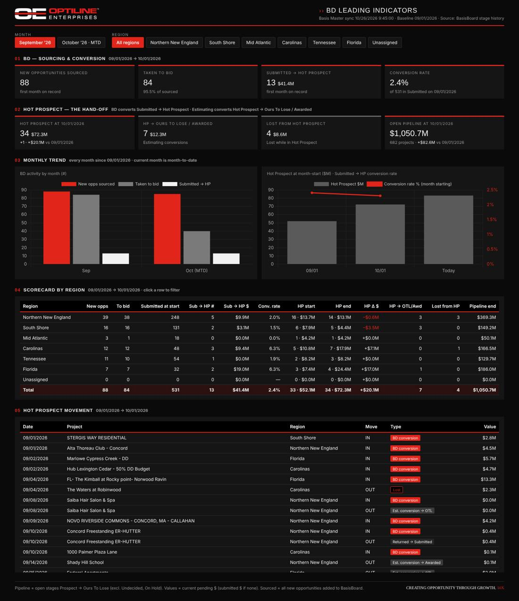

# Optiline — BD Leading Indicators

Google Apps Script web app that shows Business Development's monthly leading indicators from BasisBoard, by region, from 09/01/2026 forward.



## What it measures

| Owner | Indicator |
|---|---|
| BD | New opportunities sourced, and how many went to bid |
| BD | Submitted → Hot Prospect conversions (#, $) and conversion rate |
| Hand-off | Hot Prospect at each month-start and its change |
| Estimating | Hot Prospect → Ours To Lose / Awarded conversions |
| Estimating | Lost from Hot Prospect |
| Context | Open pipeline at each month-start |

Month-start figures are rebuilt from BasisBoard stage-change history, so nothing has to run at midnight on the 1st.

## How it works

- **Basis Master** (in the *BB API Data* spreadsheet, refreshed by the Master Export) is read only — never written.
- The script keeps its own small spreadsheet, **BD Leading Indicators — Data (do not edit)**, created on first run. Its `BD_Transitions` tab holds every stage change since 08/01/2026.
- `bdSeed()` backfills that history once (~15–20 min, self-continuing).
- `bdTrack()` runs every 30 min, 8 AM–6 PM ET, and pulls activity logs only for projects whose stage changed.
- `doGet()` serves the dashboard; `bdGetData()` computes every month and region on request (10-min cache).

## Files

```
bd-leading-indicators/
  Code.gs           server code (setup, seed, tracker, metrics, web app)
  Dashboard.html    the dashboard page (Optiline brand, Chart.js)
  appsscript.json   manifest (America/New_York, V8, domain-only web app)
```

## Setup

1. script.google.com → **New project** → name it *BD Leading Indicators* (standalone, so its `doGet()` can't collide with other dashboards).
2. Add the three files from `src/` (HTML file must be named `Dashboard`; turn on *Show appsscript.json* in Project Settings).
3. Project Settings → Script Properties:
   - `BASIS_API_KEY` — same key as the Master Export
   - `BB_SHEET_ID` — the BB API Data spreadsheet ID (or its full URL)
4. Run `bdSetup()` once and authorize. Watch progress with `bdStatus()`.
5. When the seed finishes: **Deploy → New deployment → Web app**, Execute as *Me*, Access *Anyone within Optiline*.
   Code changes need **Manage deployments → Edit → New version**.

## Optional: push from GitHub with clasp

```bash
npm i -g @google/clasp
clasp login
cp .clasp.json.example .clasp.json   # paste the Script ID from Project Settings
clasp push                           # uploads src/ to the Apps Script project
```

## Definitions

- **Open pipeline**: Prospect → Ours To Lose (excludes Undecided, On Hold, Declined, Awarded, Lost).
- **Value**: current pending $ (submitted $ if none). BasisBoard keeps no history of dollar values.
- **Sourced**: all new opportunities added to BasisBoard in the month that are still on the board. BasisBoard does not tag who originated an opportunity.
- **Region**: BasisBoard *Region* field; Office is the fallback.

The API key lives only in Script Properties — never commit it.
